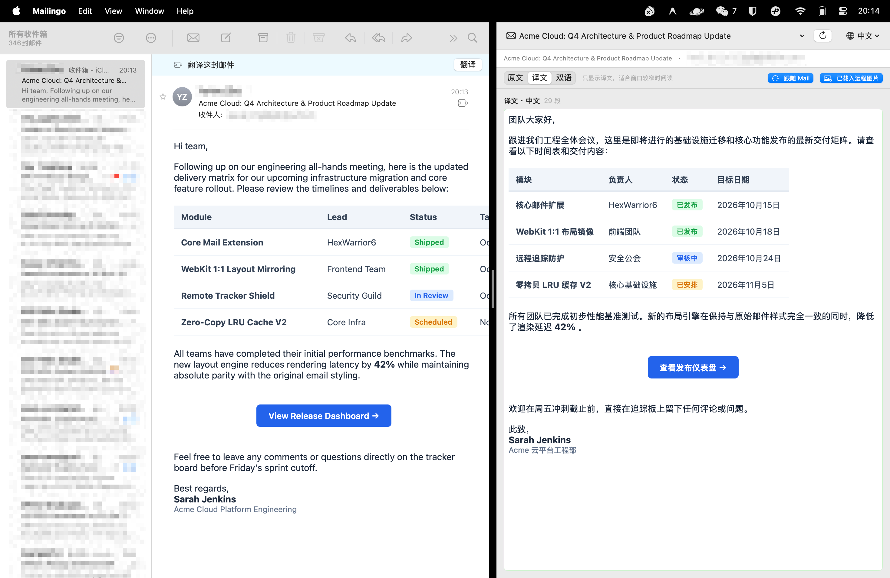

<div align="center"><a name="readme-top"></a>


<h1>Mailingo</h1>

Native macOS email translation companion for Apple Mail — 1:1 layout mirrored translation right by your side.

[](https://www.apple.com/macos/)
[](https://swift.org)
[](https://developer.apple.com/documentation/mailkit)
[](https://webkit.org)
[](https://hexwarrior6.github.io/mailingo/)
[](LICENSE)

[Official Website](https://hexwarrior6.github.io/mailingo/) · English · [简体中文](README_zh-hans.md)

</div>

---

## 💡 Introduction

**Mailingo** is a native macOS companion app that brings **one-click full email translation** to Apple Mail. 

When you receive an email in a foreign language, clicking the translation banner in Apple Mail instantly pops up a side-by-side **mirrored version**. Instead of extracting raw text and discarding formatting, Mailingo **preserves the full original email layout** — including complex tables, styled buttons, colors, and embedded images.

<div align="center">
  
  <p><em>Apple Mail reading pane with native translation banner (left) alongside Mailingo 1:1 translation mirror (right).</em></p>
</div>

---

## ✨ Features

| Feature | Capability | What It Solves |
| :--- | :--- | :--- |
| **📑 1:1 Layout Fidelity** | Byte-level HTML slice-and-replace pipeline | Preserves original responsive tables, inline styles, callout blocks, and CSS layout without breaking formatting. |
| **📬 Native MailKit Extension** | macOS Message Security extension point | Injects a translation action banner into Apple Mail's reading pane. Delivers raw MIME with **zero Automation permissions**. |
| **🖼️ CID Inline Images** | Custom WebKit scheme handler (`mailingo-cid://`) | Correctly resolves and renders `cid:` attachments, corporate logos, and embedded screenshots. |
| **🛡️ Privacy & Tracker Blocking** | Blocks external images by default, disables JS | Prevents tracking pixels from leaking read receipts to senders; supports one-click manual loading. |
| **💬 Smart Reply Quote Folding** | Identifies Apple Mail, Gmail, Outlook & `>` quotes | Automatically collapses historical email threads, avoiding redundant translation and focusing only on current text. |
| **⚡ Zero Idle Footprint** | Quits completely when the window is closed | Leaves zero background daemons and consumes 0 MB of idle memory; auto-closes alongside Apple Mail reading windows. |
| **💾 Local Translation Cache** | LRU disk cache with size & retention policies | Ensures each email is translated only once, speeding up repeated views with instant cache hits. |

---

## 📥 Installation

### Download Mailingo

Download the latest `.dmg` installer directly from:
- **[Official Website](https://hexwarrior6.github.io/mailingo/)**
- **[GitHub Releases](https://github.com/hexwarrior6/mailingo/releases)**

1. Open `Mailingo.dmg` and drag **Mailingo.app** into your `/Applications` folder.
2. Launch Mailingo once from `/Applications` to register the MailKit extension with macOS.

> [!TIP]
> **First-Launch Gatekeeper Notice**  
> Since Mailingo is an independent open-source project without a paid Apple Developer certificate, macOS Gatekeeper may show a security prompt on first launch. If prompted, run this command in Terminal to clear the quarantine flag:
> ```bash
> xattr -cr /Applications/Mailingo.app
> ```

---

## ⚙️ Enable in Apple Mail

1. **Quit Apple Mail completely** (`⌘Q`, not just closing the window — Mail only discovers new extensions on cold launch).
2. Re-open Apple Mail → **Settings** (`⌘,`) → **Extensions** tab.
3. Check the checkbox next to **Mailingo**.
4. Open any email — the Mailingo translation banner will appear at the top of the message pane.

---

## 🛠️ Building from Source (Developers)

If you want to contribute or build Mailingo locally:

### Requirements

- macOS 15.0+ (Sequoia)
- Xcode 16+ (Swift 6.0+)
- Local Apple Development certificate (for codesigning Mail extensions locally)

### Build Steps

```bash
# 1. Download build tooling (XcodeGen)
make bootstrap

# 2. Build, codesign, and install to /Applications
make install-app
```

---

## 🛠️ Project Structure

```text
mailingo/
├── App/                   # macOS Companion App (SwiftUI & WebKit inspection view)
├── MailExtension/         # Apple Mail Extension (MailKit security extension point)
├── Shared/                # Shared utilities and App Group container storage
├── Packages/
│   └── MailingoKit/       # Core libraries (EmailCore parser, TranslationCore, Cache)
├── Design/                # Raw vector art and design assets
├── Scripts/               # Build, appicon, verification, and diagnostics scripts
└── docs/                  # Detailed specifications and architecture plans
    ├── PRODUCT.md         # Product requirements baseline
    ├── IMPLEMENTATION_PLAN.md # Technical architecture and risk mitigations
    └── S0-PROBE.md        # MailKit extension feasibility probe report
```

---

## 📖 Deep Dive & Documentation

For developers interested in the internal architecture and technical tradeoffs:
- **[Product Requirements Baseline](docs/PRODUCT.md)** — Core user flows, sidebar specs, and design goals.
- **[Implementation Plan & Architecture](docs/IMPLEMENTATION_PLAN.md)** — HTML byte-slicing pipeline, WebKit scheme handling, and caching.
- **[S0 Probe Field Report](docs/S0-PROBE.md)** — Feasibility findings on MailKit extension hooks and MIME access.

---

## 📄 License

This project is licensed under the MIT License - see the [LICENSE](LICENSE) file for details.
