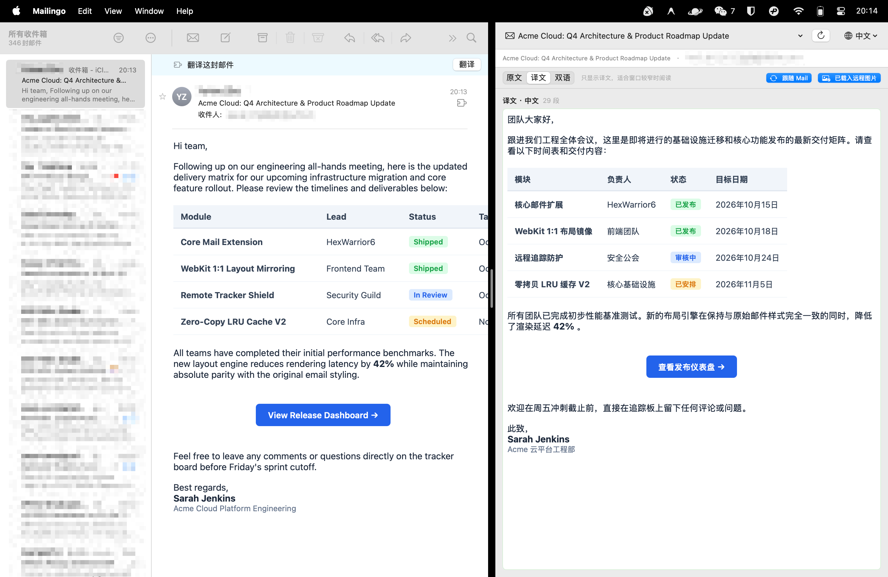

  
  <h1>Mailingo</h1>
  
Read translated emails alongside the original in Apple Mail.

  
macOS 15 or later · Apple Mail · MIT license

  
<a href="https://github.com/hexwarrior6/mailingo/releases/latest">Download</a> · <a href="https://hexwarrior6.github.io/mailingo/">Website</a> · <a href="README_zh-hans.md">简体中文</a>

## Install and translate

1. Download `Mailingo.dmg` from [GitHub Releases](https://github.com/hexwarrior6/mailingo/releases/latest), drag Mailingo into Applications, and open it once.
2. Quit Apple Mail with **⌘Q** and reopen it. In **Mail → Settings → Extensions**, enable **Mailingo**.
3. Open a message and click **翻译** (Translate) in its banner. The translation opens in a separate window so you can keep the original in view.

The release app is ad-hoc signed. If macOS blocks the first launch, verify the download against the release's `checksums.txt`. You can then clear quarantine for the app with `xattr -dr com.apple.quarantine /Applications/Mailingo.app`.

## How it works

- Translates message text while keeping HTML tables, links, styles and inline attachments in place. Remote images stay blocked until you choose to load them.
- Folds quoted replies and caches translations locally so you can revisit a message without translating it again.
- Uses Apple Translation by default. It may ask to download a language pack. The developer settings also support an OpenAI-compatible text endpoint and optional cloud image translation.

## Where email data goes

Apple Translation processes message text on the Mac. If you choose an OpenAI-compatible engine, translatable text goes to the endpoint you configure. If you configure cloud image translation and use it, the selected image goes to the configured provider. API secrets are stored in Keychain.

To pass messages from the Mail extension to the companion app, Mailingo stores recent raw messages locally in the extension's container. The translation cache and diagnostic files also stay on disk. Treat exported diagnostics and screenshots as email data before sharing them.

## Contribute

Run `make test` on a Mac with Xcode 16 or later. To build the app, run `make bootstrap` to download the pinned XcodeGen version, then follow the signing and build steps in the contributor guide.

[Contributor guide](CONTRIBUTING.md) · [Architecture](docs/README.md) · [Changelog](CHANGELOG.md) · [MIT License](LICENSE)
