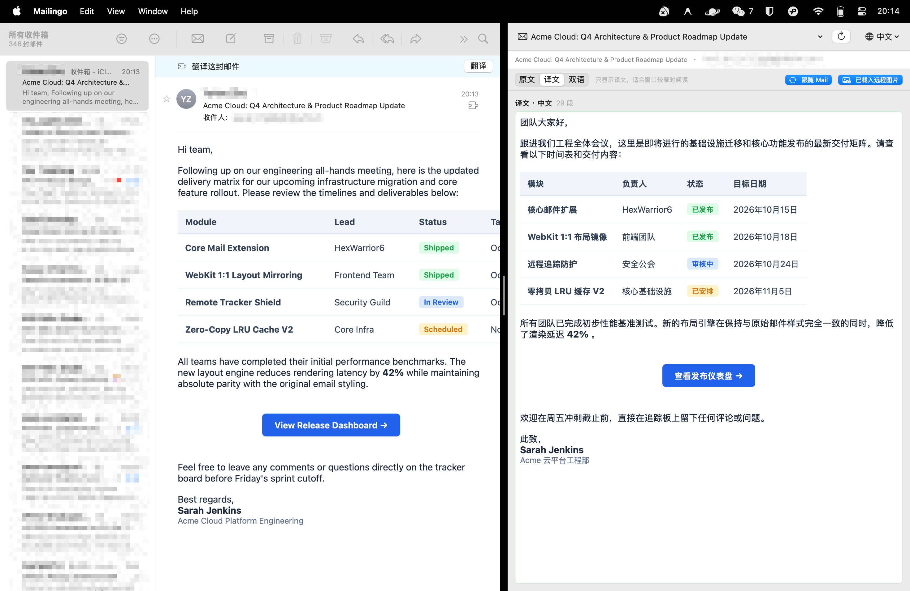

  
  <h1>Mailingo</h1>
  
在 Apple Mail 旁边阅读邮件译文，随时对照原文。

  
macOS 15 或更高版本 · Apple Mail · MIT 许可证

  
<a href="https://github.com/hexwarrior6/mailingo/releases/latest">下载</a> · <a href="https://hexwarrior6.github.io/mailingo/">官网</a> · <a href="README.md">English</a>

## 安装与使用

1. 从 [GitHub Releases](https://github.com/hexwarrior6/mailingo/releases/latest) 下载 `Mailingo.dmg`，把 Mailingo 拖入「应用程序」并打开一次。
2. 按 **⌘Q** 完全退出 Apple Mail，再重新打开。在 **邮件 → 设置 → 扩展** 中启用 **Mailingo**。
3. 打开邮件，点击横幅上的 **翻译**。译文会在独立窗口中打开，方便和原文对照。

发布包使用临时签名（ad-hoc signing）。如果 macOS 阻止首次打开，请先用发布页的 `checksums.txt` 校验下载文件，再运行 `xattr -dr com.apple.quarantine /Applications/Mailingo.app` 清除该应用的隔离属性。

## 翻译与排版

- 翻译邮件正文，保留原有的 HTML 表格、链接、样式和内嵌附件。远程图片默认拦截，可手动加载。
- 折叠历史回复，并在本机缓存译文，再次打开同一封邮件时可以复用。
- 默认使用 Apple 翻译，首次使用某些语言时可能需要下载语言包。开发者设置也支持 OpenAI 兼容接口和可选的云端图片翻译。

## 邮件数据如何处理

Apple 翻译在本机处理邮件正文。选用 OpenAI 兼容引擎时，待翻译的文字会发往你设置的接口。配置并使用云端图片翻译时，待翻译的图片会发往所选服务商。API 密钥保存在系统钥匙串中。

为把邮件从 Mail 扩展传给主应用，Mailingo 会把近期邮件的原始内容保存在本机扩展容器中。译文缓存和诊断文件也会写入本机磁盘。分享诊断文件或截图前，请先检查其中是否含邮件内容。

## 参与开发

在安装了 Xcode 16 或更高版本的 Mac 上运行 `make test`。需要构建应用时，先运行 `make bootstrap` 下载指定版本的 XcodeGen，再按贡献指南设置签名并构建。

[贡献指南](CONTRIBUTING.md) · [项目架构](docs/README.md) · [更新记录](CHANGELOG.md) · [MIT 许可证](LICENSE)
